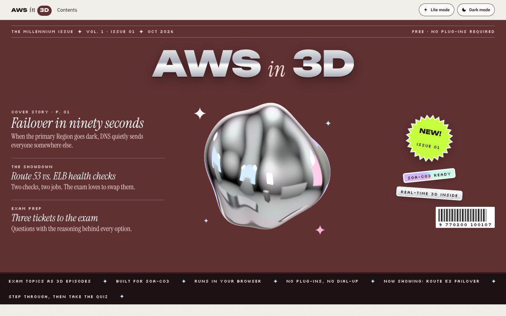
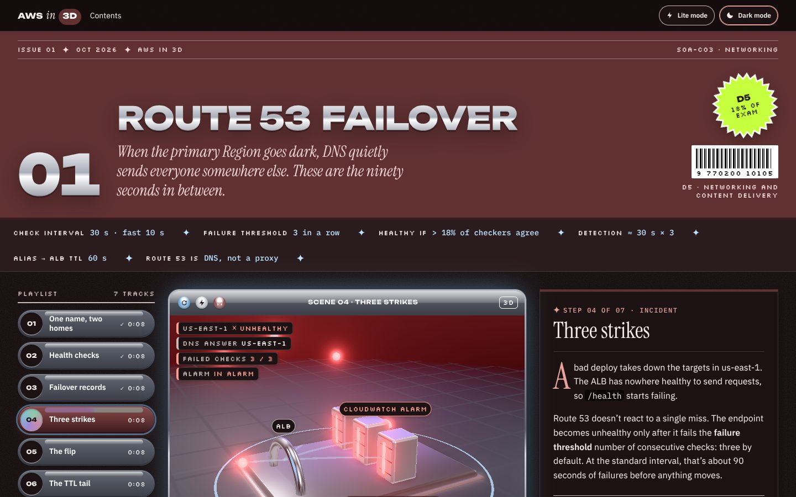
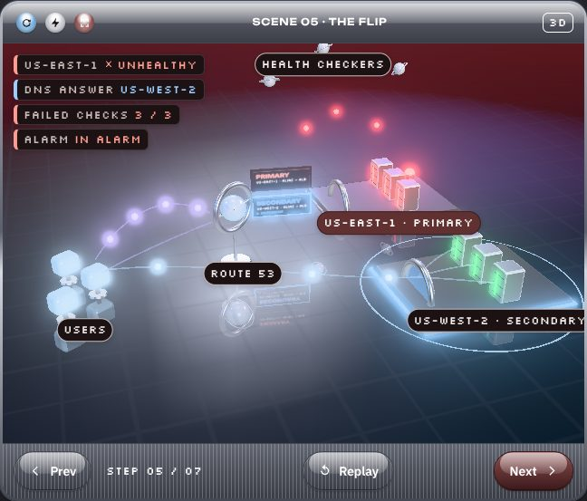
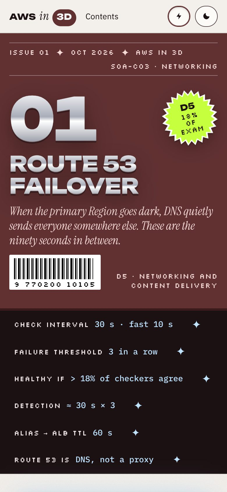

# AWS in 3D · The Millennium Issue

AWS exam topics as 3D scenes you can step through, laid out like a printed tech magazine from the year 2000 that came alive.

- **Y2K Futurism** for the materials and the 3D world: liquid chrome, glossy bevels, iridescent foil, icy blue light.
- **Editorial** for structure: issue lines, folios, oversized display type, serif italics, pull quotes, captions.
- **Maximalism** for density: stickers, starbursts, a marquee ticker, layered type.

One rule keeps it usable: a maximal frame around a calm reading core. The step narration, console clicks and quiz always sit on solid, high-contrast panels with a comfortable line length.



| Episode, dark | Stage, mid-failover | Mobile |
|---|---|---|
|  |  |  |

## Run it

```sh
npm install
npm run dev          # local dev server
npm run build        # static site in dist/
npm run preview      # serve dist/
npm run check        # WCAG AA contrast check + build
```

`dist/` uses relative URLs, so it works from any static host or sub-path (GitHub Pages included).

## What's inside

| Page | What it is |
|---|---|
| `index.html` | The cover (chrome logo, live liquid-chrome blob, cover lines, stickers, barcode), a ticker, and the table of contents as trading cards grouped by exam domain, with a domain-coverage strip. |
| `episode.html?id=…` | An episode: cover masthead, key-number ticker, a 3D stage in a Y2K OS window, a playlist rail, the editorial step panel with a terminal of console clicks, a "Not the same as" versus spread, and exam-ticket quiz questions. |

The first episode, **Route 53 Failover** (SOA-C03 domain 5), is complete. The other cards on the cover are marked *In production*. Edit `src/js/episodes/catalog.js` to change them.

```
src/
  styles/        tokens.css (all color/type/space tokens), base, editorial, episode, home
  js/
    site.js      fonts, styles, top bar toggles, colophon
    theme.js     light/dark (system or pinned), fires `themechange`
    prefs.js     reduced motion and Lite mode (auto on low-end devices)
    ui/          masthead, ticker, reader (rail + stage window + panel), versus, quiz
    stage/       three.js engine: PBR environment, sky, chrome floor, selective bloom,
                 packets, clips, retheme()
    episodes/    catalog, episode content, and each episode's scene module
    cover-blob.js
scripts/contrast-check.mjs   WCAG 2.2 AA check of every text/background pair, both themes
docs/DESIGN.md               the design system: tokens, type, components, 3D, motion, a11y
docs/moodboard/              reference board for the direction
```

## Adding an episode

1. Write `src/js/episodes/<id>.js`: masthead copy, ticker numbers, steps (text, facts, console clicks, caption, scene state, flows, beats), versus, quiz, sources. Use `route53-failover.js` as the template.
2. Write `src/js/episodes/<id>.scene.js`: actors, routes and camera shots for the stage. See the scene API at the top of `route53-failover.scene.js`.
3. Register it in `catalog.js` (`status: 'live'`) and add its loader to `loaders`.

[docs/DESIGN.md](docs/DESIGN.md) has the full step and scene data shapes.

## Accuracy

Episode facts follow the AWS documentation linked in each episode's *Further reading* section. AWS revises services and exam guides, so check those pages before exam day.

---

An independent study project, not affiliated with or endorsed by Amazon Web Services. AWS and Amazon Route 53 are trademarks of Amazon.com, Inc. or its affiliates. Fonts are from Google Fonts (via Fontsource) under the SIL Open Font License.
